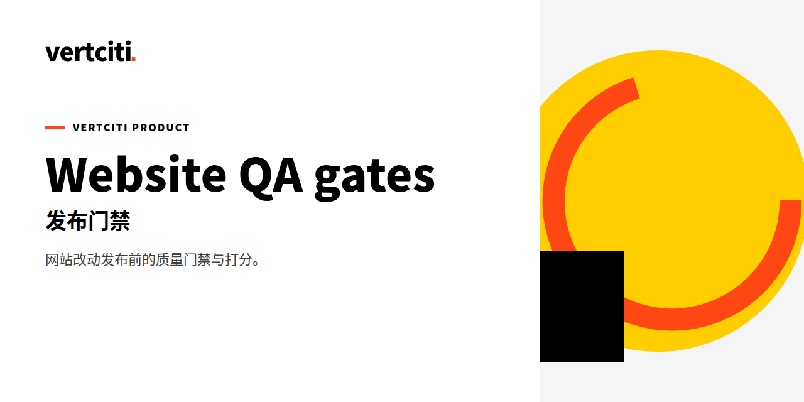

# website-qa-gates · 网站质量门禁

[English](README.md)

[](LICENSE)
[](SKILL.md)
[](https://github.com/HUIIIM/website-qa-gates/actions/workflows/qa-gates.yml)

**网站是公司成色的证明。这个技能跑发布前的全套门禁：逐门禁给出附证据的通过/不通过结论、11 维加权评分与等级，低于 A 级自动立案——让任何东西都不能靠“我看着没问题”上线。**

[官网](https://vertciti.com) · [快速开始](#快速开始) · [诚实约定](#诚实约定) · [测试实证](#测试实证)

[Quick start](#30-second-quick-start) · [What it delivers](#what-it-delivers) · [Demo](#demo) · [FAQ](#faq)

一个 [Vertciti Skill Pack](https://vertciti.com)，用于网站变更的发布前质量门禁。一份变更说明进来，三样东西出去。

为 [Miao](https://vertciti.com)（Jiahui Miao）而建——N=1 创始人 IP 基础设施。

> website-qa-gates 是 vertciti 为创始人自用的技能工具。状态：🟢 已验证（PASS · 已验证）· 数据截至 2026-10-21（见[测试实证](#测试实证)）。

## 门禁结论词状态呈现

本仓门禁结论词按 vertciti 产品 DNA 的状态色口径呈现，只加呈现层映射，原结论词本身保留不删、结论含义一字不改：

| 门禁结论词（原词保留） | 状态呈现 | 状态色 |
|---|---|---|
| PASS | PASS · 已验证 | 绿 |
| WARN | WARN · 建设中 | 黄 |
| FAIL | FAIL · 风险 | 橙 |

说明：上表对应 `vc-product.css` 的 `.vc-st` 状态色定义（已验证=绿 / 建设中=黄 / 风险=橙）。本仓历史实跑结论（如某次运行的 PASS / WAIVED / FAIL 读数）属事实记录，只做呈现映射、数字不动；`waived` 不在上表三词之列，按原文保留。

## 快速开始

### 30 秒快速开始

```bash
cd demo
bash run.sh
# Runs the real gate runner against a test page (~30s)
```

见 `demo/README.md` 了解详情。可机器运行的门禁真实执行；依赖浏览器的门禁诚实标记为 `waived`（绝不造假）。

## 它做什么

### 它解决的真实问题

网站发布前的人工 QA 容易漂成凭感觉：有人扫一眼、说没问题，结果上线带着手机端坏掉的页脚、或一个指向虚空的孤儿 CTA。website-qa-gates 用门禁清单替代眼球——每个门禁都有通过标准，且必须引用证据。无法机器验证的浏览器相关门禁诚实标记为 `waived`，绝不假装通过。

### 它交付什么

每项网站变更交付三样东西：

1. **门禁结论** —— G1–G9 + G14 发布门禁 + 4 个动效专项门禁，逐项 PASS · 已验证 / FAIL · 风险 / 有条件通过，并附证据。任何 FAIL · 风险 都阻断发布。
2. **11 维评分** —— 100 分加权模型（真实浏览器验证 18、视觉工艺 12、CTA 闭环 12、性能预算 12、……）。等级：S ≥95 / A++ ≥90 / A ≥85 / B ≥70 / C <70。
3. **自动立案** —— 低于 A 级（或任一门禁 FAIL · 风险）自动生成一份整改记录，带负责人和 24h 截止时间。

### 何时使用

| 场景 | 产出 |
|---|---|
| 首页 hero 变更 | 上线前先拿到门禁结论 + 评分 |
| 手机端（390px）页脚改版 | 对比度 + 触控目标门禁，逐项检查 |
| 新增动画 | 4 个动效专项门禁（无黑首帧、无自动播放陷阱） |
| 一次发布评为 B | 自动立案整改，带负责人 + 24h 截止时间 |

### 输入

一份变更简报，包含：

- **变更内容**：例如“首页 hero 新增数字证据条：四个数字 + 来源引用”
- **受影响视口**：桌面 / 手机（390px）/ 两者
- **材料**：变更说明、规格、截图/录屏、源码路径（缺失时检查会降级并明示）

### 结构

```
Input: change brief
  ↓  G1–G9 release gates (each: run → evidence → PASS · 已验证/FAIL · 风险)
  ↓  G14 + 4 motion-specific gates
  ↓  11-dimension weighted score → grade
  ↓  Below A or any FAIL · 风险 → auto-filed remediation (owner + 24h deadline)
  ↓  Ledger append (coverage-ledger.json, additive)
```

### 仓库结构

```
website-qa-gates/
  SKILL.md              # the skill itself: gates, scoring model, filing rules
  demo/                 # runnable test page + run.sh → coverage-ledger.json
  tools/ledger-run.py   # the real gate runner
  references/           # gate-checklist.md, scorecard-v1.yaml (machine-readable)
  evals/                # six real dry-run records (smoke-01..06)
  coverage-ledger.json  # additive ledger of real runs
```

### 参考资料

- `references/gate-checklist.md` —— 逐门禁的执行方法与通过标准。
- `references/scorecard-v1.yaml` —— 机器可读的评分模型。
- `evals/` —— 六份真实 dry-run 记录（smoke-01 至 smoke-06），每份附证据。
- `tools/ledger-run.py` —— demo 中使用的门禁运行器。

### 路线图

- 为当前 `waived` 的门禁做真实浏览器自动化（Playwright，证据捕获）。
- 基于累加台账的 A 级趋势看板。
- 随站点动画词汇增长扩充动效门禁库。

## 诚实约定

- 每个数字标注来源与抓取时间；抓不到的标“需手动补”，绝不编数。

### 诚实约定细则

- 无法在机器侧执行的门禁标记为 `waived` 并注明原因——waived 的门禁不等于通过。
- 材料缺失会使检查降级并被披露；绝不会悄悄变成通过。
- 每份 dry-run 记录都累加进 `coverage-ledger.json`（真实运行，如 `dryrun-2026-10-06-h4`）；台账就是记分牌。

## 测试实证

| 指标 | 数字 | 来源 · 数据截至 |
|---|---|---|
| 门禁自跑（demo） | pass=11 fail=0 waived=21 machine=11/32 | `bash demo/run.sh`（`tools/ledger-run.py`）本地实跑 · 2026-10-21 |
| eval 断言 | PASS · 已验证：门禁真实跑通且零 FAIL | `bash demo/eval.sh` 本地实跑 · 2026-10-21 |

### Demo

`bash run.sh` 对一个测试页运行真实门禁运行器（`tools/ledger-run.py`）——机器门禁执行、证据写入，运行结果追加进 `coverage-ledger.json`。`evals/` 中附带六份真实 dry-run 记录（smoke-01 至 smoke-06）；台账中还有一次近期的生产运行（`dryrun-2026-10-06-h4`，针对线上部署根目录）。

> 门禁运行产出结论的 walkthrough 视频/截图：待补（占位）——上面的运行记录已经真实且有证据支撑。

## FAQ

**如果我没有材料（截图、规格）会怎样？**
检查会降级并明示。材料缺失会作为范围缩减被披露——绝不会悄悄变成通过。

**`waived` 的门禁意味着发布被阻断吗？**
不——waived 意味着“无法机器验证、已诚实披露”。它会留在结论里，让人知道还有什么需要人眼看。

**为什么低于 A 就自动立案，而不是只警告？**
因为警告会被划过去。带负责人和 24h 截止时间的立案记录是闭环；警告只是希望。

**这能针对 staging URL 运行，而不是本地页面吗？**
门禁运行器可针对站点根目录或 URL 工作；依赖浏览器的门禁需要真实浏览器会话。demo 使用测试页，因此在任何地方约 30 秒即可运行。

## 参与贡献

欢迎 Issues 和 PRs。门禁变更需要在 `evals/` 里有一次工作 dry-run，外加一条 `coverage-ledger.json` 记录——没有运行记录的纸面提案不合并。

## 关于 vertciti

vertciti 把全部资源用来运营一个人的人生：创始人苗家辉。官网 [vertciti.com](https://vertciti.com) · 仿冒预警：vertciti 从未发行任何代币。

### 作者

**Jiahui Miao** —— [vertciti](https://vertciti.com) 创始人。正在构建 N=1 个人 AI 基础设施。参与 3GPP，从事 6G 核心网标准工作。

## 许可证

| 模块 | 许可证 | 白话含义 |
|---|---|---|
| 全部文件 | MIT | 可商用、可修改、需署名 |

见 [LICENSE](LICENSE)。

MIT · 运营主体 VERTCITY LLC
